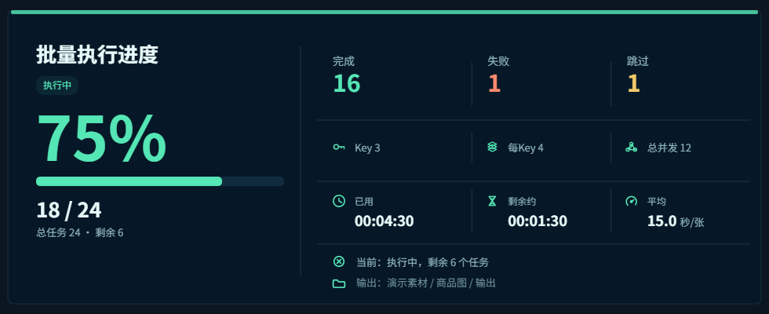
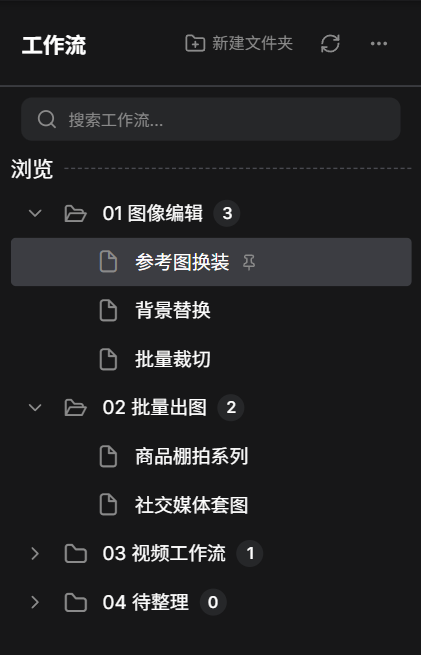
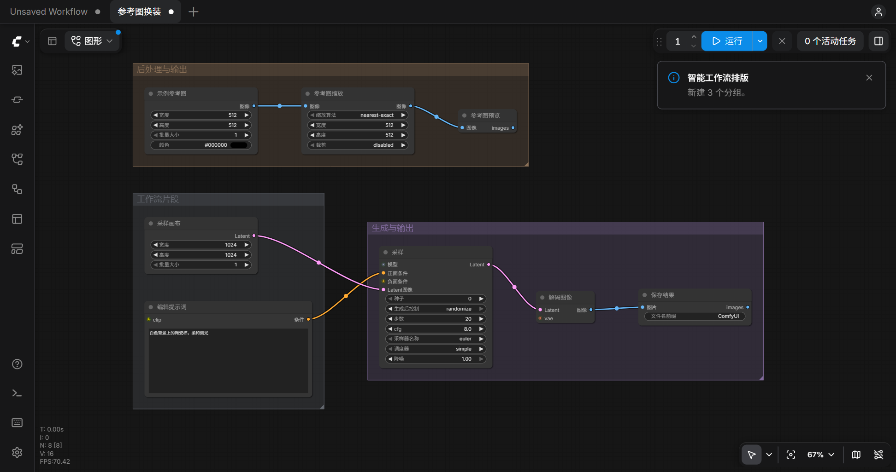
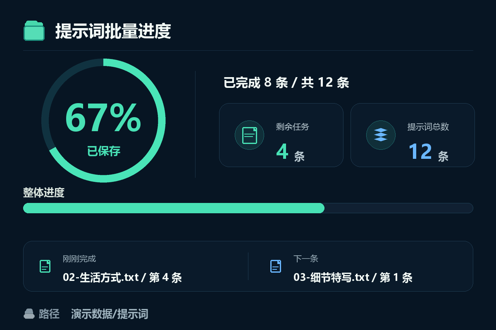

# ComfyUI-LX-Nodes · 灵犀节点合集

由 **灵犀（Lingxi）** 开发与维护。

**一个 ComfyUI 扩展，覆盖素材批处理、工作流文件管理、运行控制和画布布线。** 可以按原目录交付整批图片，在侧栏整理工作流，右键处理卡住的任务，也可以把横跨几个分组的长线收成设置点和获取点。

| 批量处理与中转 | 工作流管理 | 运行控制 | 画布组织 |
| --- | --- | --- | --- |
| [原名与目录交付](#批量加载与同名保存) · [API 并发](#中转站与并发批量) | [搜索、归档、置顶](#工作流文件管理) | [清理资源、强制停止](#右键清理与强制停止) | [实线与虚拟连线互转](#虚拟连线与广播) |

[快速安装](#安装) · [基础示例](examples/text_basic.json) · [使用手册](docs/USAGE.md)

## 批量加载与同名保存

适合商品图换背景、整批抠图换底、统一缩放或压缩后交付。源目录里有多层分类时，输出目录也可以沿用同样的结构。

```text
素材/春季/上衣/正面.jpg  →  交付/春季/上衣/正面.jpg
素材/春季/上衣/背面.jpg  →  交付/春季/上衣/背面.jpg
```

1. 用「图像计数（文件夹）」确认数量，再用「加载图像（文件夹）」逐张读取。加载节点支持筛选、排序、固定索引和自动递增。
2. `图像` 接抠图、放大或其他处理节点。`文件夹名称` 和 `图片名称` 直接接到「保存图像（文件夹）」的对应输入。
3. 设置单独的保存根目录。前缀和后缀留空、保存格式选「保持原格式」时，结果沿用源文件名和子目录。加载到的空子文件夹也可以按路径重建。需要区分版本时可以加 `_换底`、`_压缩` 等后缀，也可以统一导成 JPG、PNG 或 WebP。默认覆盖同名输出，开启「同名追加后缀」可以保留不同批次。

「保存图像（文件夹）」以 RGB 保存。交付透明抠图时，选择支持 Alpha 通道的保存节点。

### 调文件大小时，有两种入口

| 想做什么 | 用哪个节点 |
| --- | --- |
| **先按 JPEG 质量处理，再继续接下游** | 「图像高质压缩」在内存里按质量压缩，输出仍是可继续连线的 `IMAGE`。 |
| **按格式和质量调整交付文件体积** | 「保存图像（文件夹）」可调 JPG 或 WebP 的图像质量，也可用「保存图像（JPG）」直接导出。 |

## 中转站与并发批量

单张生图或改图可以从「灵犀API配置」接「灵犀生图」开始。只想改画面的一块时，用「灵犀局部编辑」接原图、遮罩和提示词，打开「保留外部」可把编辑结果合成回原图。整批素材走 API 时，任务配对和请求执行可以分别设置。

```text
灵犀单图批量（文件夹）或灵犀多图批量（文件夹） ─┐
灵犀API池（需要多个时可接 API池合并）          ─┴─→ 灵犀批量执行（文件夹）
```

- **先看任务再跑。** 可以限张数或指定单张试跑。多图批量支持按同名、末尾编号或顺序配对，也支持全部组合。比如把商品图与对应参考图匹配后再统一执行。
- **按接口能力配置并发。** 在「灵犀API池」里集中设置接口地址、模型和多个 Key。执行节点分别设置总并发上限和每个 Key 的并发。多个 API 通道可以轮流分配任务。
- **跑到哪里一眼能看到。** 打开「显示实时进度」，面板会更新已完成、失败和跳过数量，也会显示平均耗时与预计剩余时间。执行结果另有状态文本和 JSON 可查。
- **已有结果可跳过。** 同一批没跑完时，重新执行可以跳过已有输出文件；需要重做时切换到覆盖。想验收输入和结果，可以开启保存对比图。



*文件夹批量进度界面，使用演示数据。*

想把不同提示词、参考图和接口配置放到一次执行里，可以用「灵犀生图任务 → 灵犀批量执行 → 灵犀结果拆分」。Qwen3VL 图像反推也能在一次 API 请求里分析 1～4 张图，常用于提取画面描述或把参考图整理成提示词。

中转、Seedream 和 Qwen3 API 节点会把选中的图片或提示词发往你配置的服务，使用时可能产生费用。分享工作流前清空真实密钥。

## 工作流文件管理

打开左侧「灵犀工作流管理」，可以在 ComfyUI 里直接搜索、归档和管理工作流文件。

- **归档与找回。** 新建文件夹、重命名，或多选后跨目录移动。移动后可以在提示里撤销。
- **让常用工作流排前面。** 同文件夹可以拖拽排序，也能置顶、取消置顶或恢复默认顺序。排序与置顶保存在当前浏览器。
- **处理正在编辑的文件。** 移动已打开的工作流时，原标签和草稿会跟到新路径。删除单个已打开的工作流时，一次确认即可关闭并删除，弹窗会提醒未保存的修改会丢失。

侧栏使用当前 ComfyUI 用户的工作流目录。需要时可在侧栏设置里隐藏原生入口。



## 右键清理与强制停止

在画布空白处右键即可操作。

| 遇到的情况 | 选择 |
| --- | --- |
| 画布换了一轮模型，想释放资源 | **彻底清理内存/显存**，卸载模型、清理运行缓存，并显示清理前后的可用内存和显存。正在执行时，清理会等当前任务结束。 |
| 批量运行中想每隔几次清理 | 接入 **显存/内存释放** 节点，按节点执行次数设置周期，可分别控制清理缓存和卸载模型。 |
| 普通停止后当前任务仍在跑 | **强制停止当前任务**，先发出正常中断，符合条件时再尝试强制中断。这个入口也会清空等待队列。部分底层调用无法立即中断，菜单会反馈是否已经停止。 |

要查看或清理磁盘上的中转结果缓存，可以用「灵犀缓存管理」按任务类型扫描，并设置保留天数。

## 虚拟连线与广播

**把长线收成同名的设置点和获取点。** 比如模型在画布左边，三个采样分支在右边。设置点保存「主模型」这一路，各分支用同名获取点接到模型输入。

- **实线转虚拟连线。** 右键一条线选「转换为设置点/获取点」。也可以选中多个节点，在画布右键菜单里批量转换它们的输出。
- **虚拟连线转实线。** 右键设置点或获取点可以单独还原，也可按选区转换。排查时可用「全部转为真实连线」还原整张工作流里能恢复的接线。整图还原前会保存一次临时快照，使用「撤销上次全部还原」会一并回退快照之后的修改。
- **全局输入和屏蔽广播。** 多条分支共用模型、CLIP、VAE 或图像时，可把同一值广播到范围内兼容的空输入。已接线的输入走各自的线。要排除某个输入，可在该口接「屏蔽广播」。

设置点／获取点沿用了 KJNodes 和 diffus3 的方案，具体来源见[第三方源码说明](docs/THIRD_PARTY_SOURCES.md)。几组节点要一起开关时，还可以用「组控开关」或「组状态发送／接收」。

**画布已经布满节点时**，用「智能工作流排版」整理整张画布、选中节点或当前分组，也可以生成组框和可编辑说明。

<details>
<summary>查看智能排版实拍</summary>



</details>

## 更多常用节点

| 要做什么 | 节点 |
| --- | --- |
| 跑一份 TXT 的批量提示词 | 「加载提示词（TXT系列）」逐条取词，「保存图像（TXT系列）」按来源和序号保存。也可用「提示词列表」集中编辑，「提示词分段」拆成动态输出。 |
| 一次得到抠图和遮罩 | 「自动抠图」可选 BEN2、RMBG、BiRefNet 等模型；「语义抠图」可用文字指定目标。 |
| 给 Qwen 2.1 指定多张参考图和采样尺寸 | 「Qwen 2.1 多图编辑画布」支持最多 10 张参考图，单独设置参考图大小与原生采样尺寸，输出条件和 Latent 给采样器。 |
| 核对生成结果，或准备交付素材 | 「图像对比」支持分界线和批次切换；「图像缩放（按边）」和「图像批量缩放（按边）」支持等比处理。 |
| 把文字输进工作流 | 「语音识别输入」「语音识别输入Plus」支持本地录音识别，另有离线翻译、批量文本替换和展示节点。 |

<details>
<summary>查看 TXT 批量进度预览</summary>

加载提示词或图片后，把「实时进度预览」接到 ComfyUI 的「预览图像」。



*预览图使用演示数据。*

</details>

## 安装

### 从 GitHub 安装

1. 在 `ComfyUI/custom_nodes/` 中克隆仓库。

   ```bash
   git clone https://github.com/lingxi-aigc/ComfyUI-LX-Nodes.git
   ```

   也可以在仓库页点 **Code → Download ZIP**，解压后把包含 `__init__.py` 的目录放到 `ComfyUI/custom_nodes/ComfyUI-LX-Nodes`。
2. 进入插件目录，用 **运行 ComfyUI 的 Python** 安装基础依赖。

   ```bash
   python -m pip install -r requirements.txt
   ```

3. 重启 ComfyUI 并刷新页面。搜「灵犀」或 `LX`，或从左侧打开「灵犀工作流管理」。
4. 拖入[基础文本示例](examples/text_basic.json)试跑。它只需要基础文本节点。

首发版已在独立的 Windows 环境验证，使用 ComfyUI `0.46.2`、前端 `1.59.6` 和 Python `3.12.10`。抠图、语音、离线翻译等高级功能按需安装 `requirements-full.txt` 和相应模型。有问题可以先运行「灵犀环境诊断」。

[节点使用手册](docs/USAGE.md) · [高级依赖](docs/USAGE.md#依赖) · [模型及外部资源](docs/EXTERNAL_RESOURCES.md) · [API 私有配置](docs/USAGE.md#本地私有配置) · [旧版迁移](docs/USAGE.md#从三个独立插件升级)

## 许可与发布

项目源码采用 [GPL-3.0-only](LICENSE)。随包的第三方声明和许可见 [NOTICE](NOTICE) 及[源码来源](docs/THIRD_PARTY_SOURCES.md)。

首发包含 Qwen 2.1 多图编辑画布和 Qwen3VL 多图 API。Qwen Image 2.1 PE 提示词增强及其专用 PE 画布待确认源码再分发许可后再考虑发布。 [首发范围](docs/OPEN_SOURCE_REVIEW.md) · [运行验收](docs/RELEASE_VALIDATION.md) · [发布说明](docs/RELEASING.md) · [参与开发](CONTRIBUTING.md)
